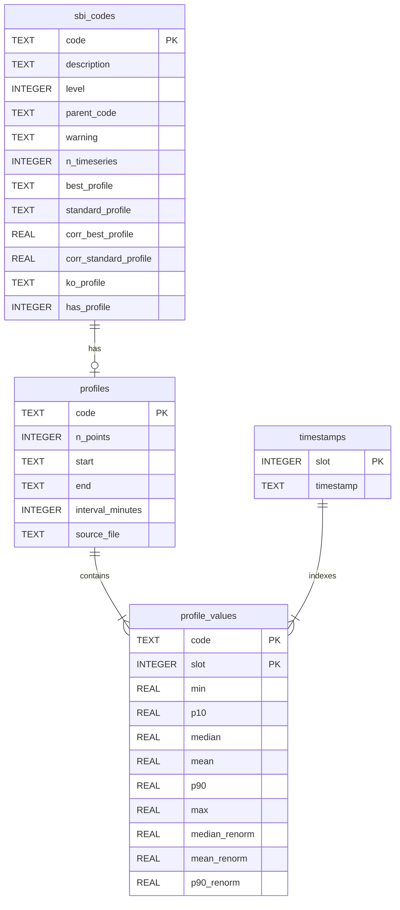

# Data model

The database is a plain SQLite 3 file. You can open it with
`ProfileDatabase`, with `sqlite3.connect()`, or with any SQL tool.



## Tables

### `sbi_codes`

The full SBI dictionary, with one row per code. See [The data](data.md#sbi-dictionary)
for the meaning of each column. Two columns are derived:

- `level`: number of digits (2 to 5).
- `parent_code`: the code one level up (`8411` → `841`), or `NULL` for
  2-digit codes.

### `profiles`

One row per profile loaded from a CSV: number of points, first and last
timestamp, and the detected interval in minutes.

### `timestamps`

The time axis shared by all profiles. Storing an integer `slot` per value
instead of the full timestamp string keeps the database compact.
Timestamps use ISO format `YYYY-MM-DD HH:MM:SS`, so string comparison
matches chronological order.

### `profile_values`

The measurements, one row per `(code, slot)`. This is a `WITHOUT ROWID`
table clustered on its primary key, so reading one profile is a single range
scan.

### `profile_timeseries` (view)

`profile_values` joined with `timestamps`, for convenient ad-hoc SQL:

```sql
SELECT timestamp, mean, p90
FROM profile_timeseries
WHERE code = '8411' AND timestamp >= '2023-12-25' AND timestamp < '2023-12-27';
```

### `metadata`

Key/value pairs describing the build: `schema_version`, `package_version`,
`built_at`, `n_profiles`, `n_sbi_codes`, `n_timestamps` and `value_columns`.

## Size and performance

For the 2023 dataset (203 profiles × 35,040 points × 9 statistics):

| Item                                | Value       |
|-------------------------------------|-------------|
| Source CSVs                         | ≈ 1.2 GB    |
| SQLite database                     | ≈ 717 MB    |
| Build time                          | < 1 min     |
| `get_profile()` (one full year)     | ≈ 0.1 s     |
| `get_profiles()` (all, one column)  | ≈ 5 s       |

## Schema versioning

`SCHEMA_VERSION` is stored in the `metadata` table. When a new release
changes the layout incompatibly, the version is bumped and
`ProfileDatabase` logs a warning when it opens an older file. Rebuild with
`--overwrite` to upgrade.
