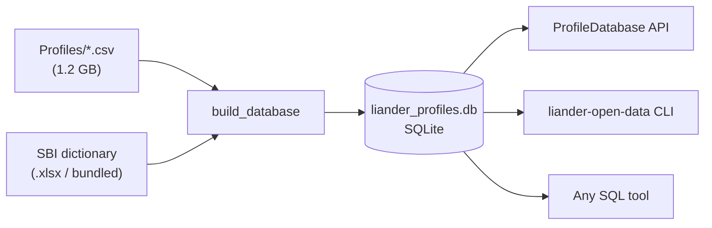

# liander-open-data

**liander-open-data** packs the
[Liander open data](https://www.liander.nl/over-ons/open-data) *SBI load
profiles* into a single, lightweight **SQLite database** and gives you a
small Python API and command line tool to query it.

Liander, a Dutch distribution system operator, publishes 15-minute
electricity consumption profiles aggregated per **SBI code** (*Standaard
Bedrijfsindeling*, the Dutch Standard Industrial Classification), plus a
workbook that tells you **which profile to use for each SBI code**. This
package combines both.

## Highlights

- **One file, no server.** All 203 profiles (≈7 million rows) and 1,427 SBI
  codes go into one portable `.db` file. Python, the `sqlite3` CLI,
  DBeaver, DuckDB and R can all open it.
- **Lossless.** Values are stored as 64-bit floats and round-trip exactly to
  the source CSVs.
- **Fast enough.** One full-year profile loads in about 0.1 s, and all
  profiles for a single statistic load in about 5 s.
- **Batteries included.** The cleaned SBI dictionary ships with the package,
  so `load_dictionary()` works without any download.
- **Typed, tested, documented.**

## At a glance

```python
from liander_open_data import ProfileDatabase

with ProfileDatabase("liander_profiles.db") as db:
    entry = db.lookup("8411")
    print(entry.description, "->", entry.recommended_profile)
    # Algemeen overheidsbestuur -> 841

    df = db.recommended_profile("8411", columns=["mean", "p90"])
    df.resample("D").mean().plot()
```



Next: [Installation](installation.md) · [Quick start](quickstart.md)
